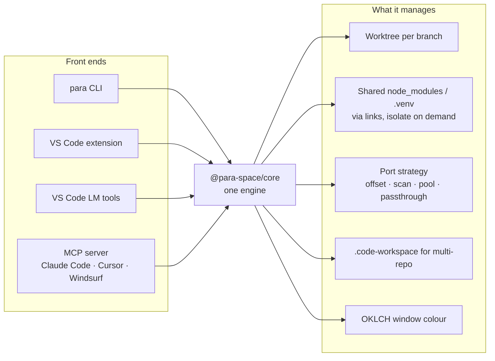
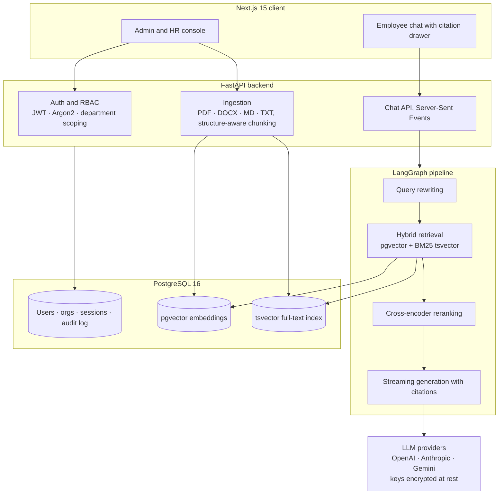
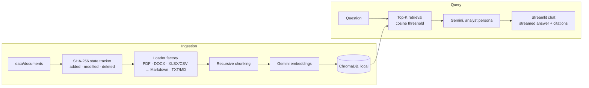
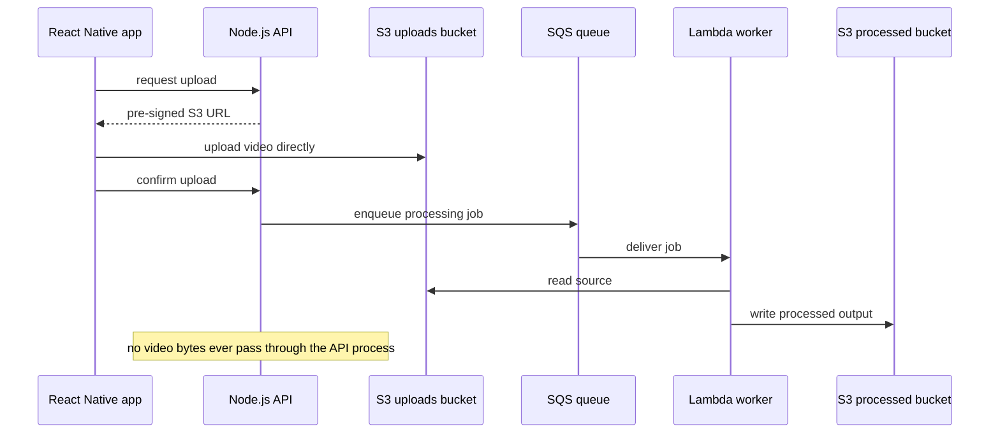

# Sarthak Jain

**Full Stack & AI Engineer.** Web, mobile and LLM systems in production.

<p>
  <a href="https://www.linkedin.com/in/sarthak-jain-tech"></a>
  <a href="mailto:sarthakj.dev@gmail.com"></a>
  
</p>

I have spent 3+ years building products end to end: LLM-powered backends, React Native apps, serverless pipelines on AWS and payment infrastructure. I care about systems that are simple to operate and hard to break.

**Now**

- Engineering at **Turom**, an AI travel-planning SaaS: the React Native app, a serverless media pipeline, LangChain workflows and the payments layer.
- Maintaining **[ParaSpace](https://github.com/SarthakJain23/para-space)**, an open-source Git worktree orchestrator for running several coding agents in parallel.
- Working AI-native day to day with Claude Code, Cursor and Gemini Antigravity.

## GitHub activity

<p>
  
  
</p>
<p>
  
</p>

## Featured projects

### [ParaSpace](https://github.com/SarthakJain23/para-space)

[](https://github.com/SarthakJain23/para-space/actions/workflows/ci.yml)
[](https://www.npmjs.com/package/@para-space-dev/cli)
[](https://marketplace.visualstudio.com/items?itemName=para-space.para-space-vscode)
[](https://github.com/SarthakJain23/para-space/blob/main/LICENSE)

Running several branches or coding agents at once in one repo means stashing, reinstalling dependencies and fighting over port 3000. ParaSpace gives every task its own Git worktree with shared dependencies, a stable port and a coloured IDE window, so parallel work stays parallel. It ships as a CLI (`para`) and a VS Code extension, and exposes a Model Context Protocol (MCP) server so Claude Code, Cursor and Windsurf can manage worktrees themselves.

`TypeScript` · `Node.js` · `VS Code API` · `MCP` · `pnpm monorepo`




| Feature | What it does |
|:--|:--|
| Zero-duplication dependencies | New worktrees link to the main checkout's `node_modules`, `.venv` and `.env`, so a branch costs seconds and no disk. `para isolate` breaks the link when a branch needs its own. |
| Per-worktree ports | Four strategies (`offset`, `scan`, `pool`, `passthrough`) give each worktree a stable dev-server port, saved in `.para-space.json`. |
| Multi-repo workspaces | `para workspace create` discovers sibling repos, provisions a worktree in each, generates a `.code-workspace` and opens it. If any repo fails, the run rolls back. |
| Divergence detection | Manifest watchers and `para check` warn when a worktree's dependencies drift from the shared set, with one-click isolation. |
| Agent integration | `para setup-agent` registers the MCP server; VS Code Language Model tools expose the same commands to Copilot-style agents. Every command accepts `--yes` so nothing prompts. |
| VS Code UI | Worktrees sidebar, status-bar quick switcher, context-history ledger and a port-strategy configurator. |

```bash
npm install -g @para-space-dev/cli
para create feat/TK-101 --base main -r "Auth redesign"   # worktree + shared deps + its own port
para workspace create feat/TK-101                        # same branch across frontend + backend repos
para setup-agent                                         # register the MCP server with your agent
```

<details>
<summary>Design notes</summary>

- **Links, not copies.** Sharing one dependency tree across worktrees is the whole point; the trade-off is divergence, so watchers and `para check` exist to make that visible, and `isolate` is the escape hatch.
- **Strategy pattern everywhere.** Frameworks (Node, Python, env files) and port strategies are pluggable modules under `packages/core`, so adding a language or allocation scheme does not touch the commands.
- **One engine, many front ends.** The CLI, extension, LM tools and MCP server are thin layers over `@para-space/core`, which does no terminal I/O. That keeps behaviour identical whether a human or an agent drives it.
- **Clean repos.** State lives in `~/.para-space/`; the only in-repo file is `.para-space.json`, excluded through `.git/info/exclude`.
- **Living docs.** Decision log, flow document and contributor guidelines ship with the code and are updated with every change.

</details>

### [PolicyHelper](https://github.com/SarthakJain23/PolicyHelper)

Company policy lives in dense handbooks, and employees file tickets to ask about leave, reimbursements or IT rules. PolicyHelper is a self-hosted assistant that answers those questions from the actual documents, scoped to the employee's department, with a citation on every answer. Documents and embeddings never leave your database.

`FastAPI` · `Next.js 15` · `LangChain / LangGraph` · `PostgreSQL + pgvector` · `TypeScript` · `Tailwind v4`



| Feature | What it does |
|:--|:--|
| Hybrid retrieval | Dense vector search in pgvector and sparse BM25 keyword search in `tsvector`, merged and reranked, so exact policy terms and paraphrased questions both hit. |
| Verifiable citations | Every answer carries document name, page, section header and the matched excerpt. Clicking a citation opens the exact passage with its similarity score. |
| Structure-aware ingestion | Hierarchical, header-aware chunkers keep context like "4.2 Parental Leave > Eligibility" intact instead of splitting mid-sentence. Storage is pluggable: local disk, S3, MinIO or R2. |
| Department-scoped RBAC | Super Admin, HR Admin, Manager and Employee roles. Documents are assigned to departments and queries respect the asker's clearance automatically. |
| Multi-LLM | OpenAI, Anthropic or Gemini per organisation, switchable from the admin UI. API keys are Fernet-encrypted at rest. |
| Audit and chat history | Searchable log of queries, uploads, configuration changes and auth events. Multi-session chat with auto-generated titles. |

```bash
git clone https://github.com/SarthakJain23/PolicyHelper && cd PolicyHelper
cp .env.example .env && docker compose up -d                        # PostgreSQL + pgvector
cd apps/api && uv sync && uv run alembic upgrade head && uv run uvicorn app.main:app --reload
cd apps/web && pnpm install && pnpm dev                             # http://localhost:3000
```

<details>
<summary>Design notes</summary>

- **PostgreSQL does everything.** Relational data, vectors and full-text search live in one engine, which removes a separate vector database from the deployment and keeps department scoping a plain SQL filter on the retrieval query.
- **Hybrid over pure vector.** Policy questions often hinge on exact terms (form names, clause numbers) that embeddings blur. BM25 catches those; the reranker settles the merged list.
- **LangGraph as the control flow.** Rewriting, routing and reranking are explicit graph nodes, so each step can be inspected and swapped without touching the API layer.
- **Streaming first.** Tokens go out over SSE as they are generated, and the citation payload arrives with them so the UI never waits for a full answer.
- **Security defaults.** HTTP-only cookie JWTs, Argon2 hashing, forced password reset on first login, encrypted provider keys.

</details>

### [Business Analyst RAG](https://github.com/SarthakJain23/business_analyst_rag)

A Retrieval-Augmented Generation (RAG) app for financial reports. Drop PDFs, Word files and spreadsheets into a folder and ask about trends, risks and specific figures. Only changed files are re-indexed, and every answer shows its sources with match scores.

`Python` · `Google Gemini` · `LangGraph` · `ChromaDB` · `Streamlit` · `Pydantic`



| Feature | What it does |
|:--|:--|
| Incremental sync | Files are tracked by SHA-256. Added and modified documents are re-embedded; deleted ones are evicted from the index. No full rebuilds. |
| Table-aware parsing | Excel and CSV sheets are converted to Markdown tables before chunking so the model keeps rows and columns together. |
| Tunable retrieval | Top-K, similarity threshold and temperature are sliders in the sidebar, applied per query. |
| Analyst persona | System prompts are tuned for trend analysis, risk identification and metric extraction, with strict evidence-backed citations. |
| Local by default | Embeddings and state metadata persist on disk under `data/`; nothing is sent anywhere except the Gemini API calls. |

```bash
git clone https://github.com/SarthakJain23/business_analyst_rag && cd business_analyst_rag
cp .env.example .env                                   # add your GOOGLE_API_KEY
uv venv && source .venv/bin/activate && uv pip install -r requirements.txt
streamlit run app.py                                   # drop files into data/documents and sync
```

<details>
<summary>Design notes</summary>

- **State tracking before embeddings.** Hashing the source files is cheap; embedding is not. The tracker decides what work is needed before any model call.
- **Loader factory.** Each format has its own loader returning LangChain `Document` objects, and auto-detection picks one by extension, so adding a format is one file.
- **Thresholded retrieval.** A cosine-similarity floor stops weak matches from reaching the prompt, which matters more for numbers than for prose.
- **Pydantic settings.** Models, paths and keys are typed configuration loaded from `.env`, with fallbacks across Gemini model versions.

</details>

<details>
<summary><b>More repositories</b></summary>

<br>

| Series | What it covers | Repos |
|:--|:--|:--|
| Low-Level Design | Object-oriented design and patterns in TypeScript: Strategy, Observer, State, Builder, Singleton, Chain of Responsibility, token bucket and sliding window | [Snakes & Ladders](https://github.com/SarthakJain23/snakes-and-ladders-lld) · [Splitwise](https://github.com/SarthakJain23/splitwise-lld) · [ATM](https://github.com/SarthakJain23/atm-machine-lld) · [Doctor Appointment](https://github.com/SarthakJain23/doctor-appointment-lld) · [Rate Limiter](https://github.com/SarthakJain23/rate-limiter-lld) · [Logger](https://github.com/SarthakJain23/logger-lld) · [Customer Service](https://github.com/SarthakJain23/customer-service-lld) |
| React Native | Navigation, auth flows with token management, push notifications with Expo, maps and camera, expense analytics | [Food Blog](https://github.com/SarthakJain23/Food-Blog-RN) · [Push Notifications](https://github.com/SarthakJain23/Push-Notifications-RN) · [Favourite Places](https://github.com/SarthakJain23/Favourite-Place-RN) · [Auth Management](https://github.com/SarthakJain23/Authentication-Management-RN) · [Expense Manager](https://github.com/SarthakJain23/Expense-Management-RN) · [Guess the Number](https://github.com/SarthakJain23/Guess-The-Number-RN) |
| LangChain | Six chapters: agents and tool calling, RAG ingestion and LCEL chains, documentation assistant, LangGraph, reflection and reflexion agents | [langchain-course](https://github.com/SarthakJain23/langchain-course) |
| Web | Issue tracker with Next.js, Prisma and PostgreSQL, [deployed on Vercel](https://issue-tracker-nu-livid.vercel.app) | [Issue-Tracker](https://github.com/SarthakJain23/Issue-Tracker) |

</details>

## Experience

<details open>
<summary><b>Full Stack & Mobile Engineer</b> · Turom, AI travel planning SaaS · Gurgaon · Aug 2025 – present</summary>

<br>

*Remix.js, Express, FastAPI, LangChain, React Native, MySQL, AWS (Lambda, SQS, S3)*

- Built and shipped the React Native app end to end: navigation, deep linking, push notifications and Apple In-App Purchases.
- Redesigned video upload as a serverless pipeline (pre-signed S3, SQS, Lambda), which removed media buffers from the Node.js event loop and ended recurring heap-memory failures and daily API slowdowns.
- Built LangChain async workflows that extract user-provided information into structured form fields, with schema validation before anything reaches business logic.
- Designed a provider-agnostic payment service that unifies Apple IAP and Stripe fee calculations behind one interface.
- Built an admin-configurable referral engine: eligibility steps, rewards and pricing live in the database, so campaigns change without a deploy. Onboarded ~4,000 users per college within 3 days across 4 campaigns.

**Video pipeline, before and after**



</details>

<details>
<summary><b>Full Stack Developer</b> · Care.Fi, B2B health fintech · Gurgaon · Apr 2024 – Aug 2025</summary>

<br>

*Python, Django REST Framework, NestJS, React, Next.js, PostgreSQL, Celery, Docker*

- Migrated the Business Rule Engine from Java Spring Boot to Python DRF, removing a single-engineer bottleneck so the whole team could ship on it, and shortening deployment cycles.
- Automated Credit Analysis Memorandum generation end to end, cutting report time by 70%.
- Integrated GST, bureau (CIBIL, CRIF) and financial-system APIs supporting ~10,000 loan applications per day.
- Built Metabase dashboards on optimised PostgreSQL KPI queries for 25 internal users and 600 to 700 hospital partners.

</details>

<details>
<summary><b>Front End Developer</b> · Heartiee Greetings, design studio · Chandigarh · Mar 2022 – Apr 2024</summary>

<br>

*React, Next.js*

- Built responsive React and Next.js websites, improving customer engagement and brand consistency.

</details>

## Stack

| | | |
|:--|:--|:--|
| **Languages** | <a href="https://skillicons.dev"></a> | TypeScript, JavaScript, Python, SQL |
| **Frontend & Mobile** | <a href="https://skillicons.dev"></a> | React, React Native, Next.js, Remix, Tailwind |
| **Backend & Data** | <a href="https://skillicons.dev"></a> | Node/Express, NestJS, FastAPI, Django, PostgreSQL, MySQL, MongoDB, Redis |
| **AI & Cloud** | <a href="https://skillicons.dev"></a> | LangChain, LangGraph, RAG, Gemini, pgvector, ChromaDB, AWS (Lambda, SQS, S3), Docker, GitHub Actions |
| **AI-assisted development** | | Claude Code, Cursor, Gemini Antigravity, MCP, parallel worktrees, spec-first prompting |

## Education & achievements

| | |
|:--|:--|
| **B.E. Computer Science Engineering** | Chitkara University, 2021 – 2025 · CGPA 9.73 / 10 |
| **1st place, Coding Ninjas Codathon 2023** | Competitive programming |
| **1000+ DSA problems** | LeetCode, Coding Ninjas, GeeksforGeeks |

<p align="center">
  <a href="https://www.linkedin.com/in/sarthak-jain-tech"></a>
  <a href="mailto:sarthakj.dev@gmail.com"></a>
</p>
